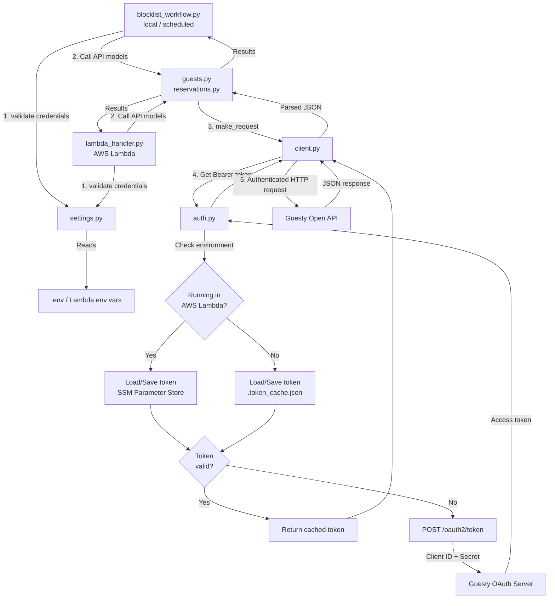
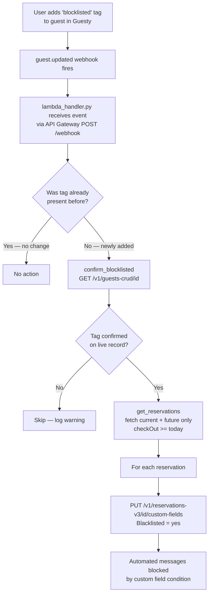
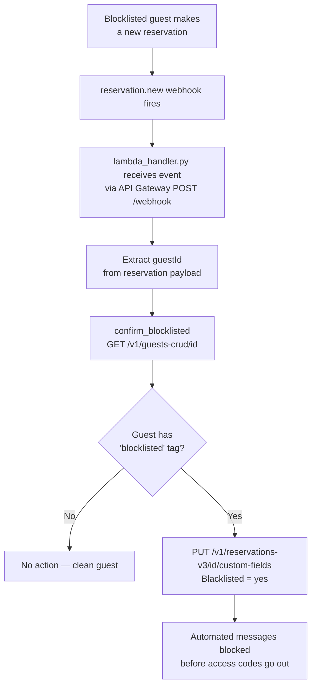

# Guesty API Client

Python client for the [Guesty Open API](https://open-api-docs.guesty.com) with OAuth 2.0 authentication, token caching, modular model structure, and automated blocklist enforcement via webhooks deployed on AWS Lambda.

---

## Application Workflow



---

## Blocklist Automation

### The Problem

Guesty has two separate concepts that don't talk to each other:

| Concept | Scope | Can block automated messages? |
|---|---|---|
| `blocklisted` **tag** | Guest profile — follows the guest everywhere | No |
| `Blacklisted` **custom field** | Reservation-specific — must be ticked per reservation | Yes |

There is no native Guesty feature to automatically tick the custom field when the tag is present. This project bridges that gap via webhooks.

### Solution: Two Automated Triggers

#### Trigger 1 — Guest gets the `blocklisted` tag (`guest.updated`)



#### Trigger 2 — New reservation arrives from a blocklisted guest (`reservation.new`)



### Batch Reconciliation (`blocklist_workflow.py`)

In addition to real-time webhooks, a batch scan can be run manually or on a schedule as a safety net — to catch any guests tagged before the webhook was registered, or if a webhook delivery was missed.

```bash
python blocklist_workflow.py
```

---

## Project Structure

```
Guesty-API/
├── .env                    # Your credentials (never commit this)
├── env.example             # Template for credentials
├── .gitignore
├── .samignore              # Files excluded from SAM deployment zip
├── requirements.txt
├── template.yaml           # AWS SAM template (Lambda + API Gateway)
├── DEPLOYMENT.md           # Step-by-step AWS deployment guide
├── settings.py             # Loads env vars; validate() called on startup
├── auth.py                 # OAuth token fetching — disk cache (local) or SSM (Lambda)
├── client.py               # Base HTTP request handler
├── reservations.py         # Reservation API calls
├── guests.py               # Guest API calls
├── blocklist_workflow.py   # Batch: scan all guests and flag blocklisted reservations
└── lambda_handler.py       # Lambda entry point — routes webhook + health events
```

---

## Setup

**1. Install dependencies**
```bash
pip install -r requirements.txt
```

**2. Configure credentials**
```bash
copy env.example .env
```
Then open `.env` and fill in your values:

| Variable | Description |
|---|---|
| `GUESTY_CLIENT_ID` | From Guesty Dashboard → Integrations → API → Open API Keys |
| `GUESTY_CLIENT_SECRET` | Same location |
| `GUESTY_WEBHOOK_SECRET` | Svix signing secret — set after registering your webhook URL with Guesty |
| `GUESTY_BASE_URL` | Default: `https://open-api.guesty.com` |
| `GUESTY_TOKEN_URL` | Default: `https://open-api.guesty.com/oauth2/token` |
| `TOKEN_SSM_PARAM` | SSM parameter name for token cache (default: `/guesty/token_cache`) — Lambda only |
| `LOG_LEVEL` | Default: `INFO` |

**3. Run the batch workflow locally**
```bash
python blocklist_workflow.py
```

---

## Lambda Deployment

See `DEPLOYMENT.md` for the full step-by-step guide. Quick reference:

**1. Build**
```bash
sam build
```

**2. Deploy (first time — guided)**
```bash
sam deploy --guided
```

**3. Deploy (subsequent)**
```bash
sam deploy
```

SAM reads `template.yaml` and creates:
- A Lambda function (`guesty-webhook`) running `lambda_handler.lambda_handler`
- An API Gateway with two routes: `POST /webhook` and `GET /health`
- An SSM parameter (`/guesty/token_cache`) for OAuth token caching

**4. Register the webhook URL in Guesty**

After deployment, SAM outputs your `WebhookUrl`. Guesty has no UI for webhook management — registration must be done via API. See `DEPLOYMENT.md` Step 5 for the full PowerShell commands.

Subscribe to these four event types:

| Event | Purpose |
|---|---|
| `guest.updated` | Detects when the `blocklisted` tag is added or removed |
| `guest.created` | Catches guests imported with the tag already present |
| `guest.deleted` | Logs the deletion for audit purposes |
| `reservation.new` | Flags new bookings from blocklisted guests immediately |

**5. Verify it's running**
```
GET https://<api-id>.execute-api.<region>.amazonaws.com/prod/health
→ {"status": "healthy"}
```

---

## Configuring the Blacklisted Custom Field

The `BLACKLIST_CUSTOM_FIELDS_PAYLOAD` in `blocklist_workflow.py` is pre-configured with the correct field:

```python
BLACKLIST_CUSTOM_FIELDS_PAYLOAD = {
    "customFields": [
        {"fieldId": "64e326bf71323c004cd765ac", "value": True}
    ]
}
```

| Field | Value |
|-------|-------|
| `fieldId` | `64e326bf71323c004cd765ac` |
| `displayName` | `blacklisted` |
| `type` | `boolean` |
| `object` | `reservation` |
| API endpoint | `PUT /v1/reservations-v3/{id}/custom-fields` |

To find all account custom field definitions (e.g. if the field ID changes):
```powershell
Invoke-RestMethod -Method Get -Uri "https://open-api.guesty.com/v1/accounts/5c6b138eb0d8cc001f20f651/custom-fields" -Headers @{ Authorization = "Bearer $token" } | ConvertTo-Json -Depth 10
```

---

## Usage Examples

```python
import reservations
import guests

# Reservations
all_reservations = reservations.get_all(limit=10, status="confirmed")
single_res = reservations.get_by_id("res123")
reservations.approve("res123")

# Guests
all_guests = guests.get_all(limit=10)
new_guest = guests.create("Jane Smith", "jane@example.com", "+61400000000")
```

---

## Token Management

Token caching uses two backends depending on environment:

| Environment | Backend | Location |
|---|---|---|
| Local dev | Disk | `.token_cache.json` (auto-generated, never commit) |
| AWS Lambda | SSM Parameter Store | `/guesty/token_cache` (created by `template.yaml`) |

- Auto-refreshes 5 minutes before expiry
- Guesty limits renewals to **3 per 24 hours** — the cache keeps you well within this limit in both environments

---

## Adding a New Model

1. Create `your_model.py` in the project root
2. Import `make_request` from `client`

```python
# webhooks.py
from client import make_request

def get_all() -> dict:
    return make_request("GET", "/v1/webhooks")
```
