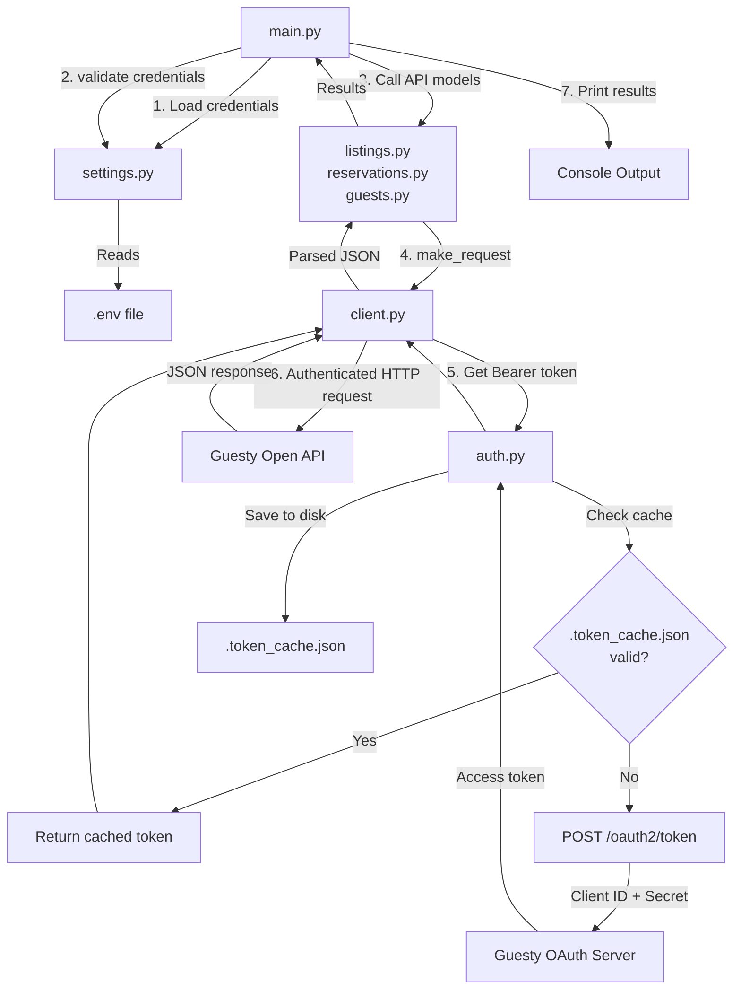
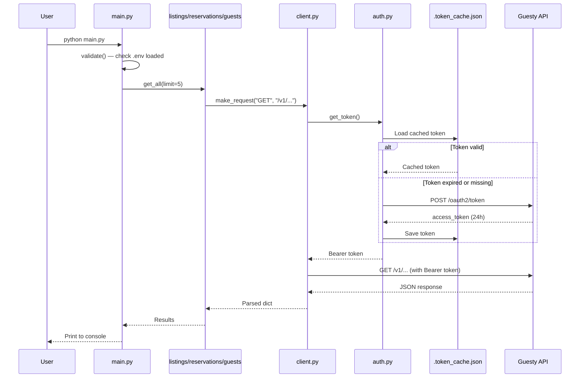
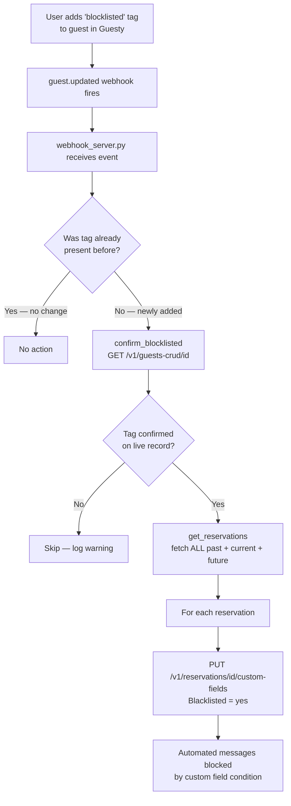
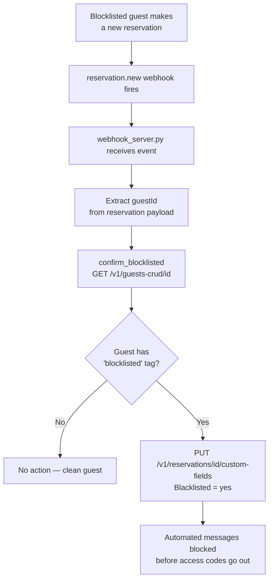

# Guesty API Client

Python client for the [Guesty Open API](https://open-api-docs.guesty.com) with OAuth 2.0 authentication, token caching, modular model structure, and automated blocklist enforcement via webhooks.

---

## Application Workflow



### Request Lifecycle



---

## Blocklist Automation

### The Problem

Guesty has two separate concepts that don't talk to each other:

| Concept | Scope | Can block automated messages? |
|---|---|---|
| `blocklisted` **tag** | Guest profile — follows the guest everywhere | No |
| `Blacklisted` **custom field** | Reservation-specific — must be ticked per reservation | Yes |

There is no native Guesty feature to automatically tick the custom field when the tag is present. This project bridges that gap via webhooks.

### Solution: Two Automated Triggers

#### Trigger 1 — Guest gets the `blocklisted` tag (`guest.updated`)



#### Trigger 2 — New reservation arrives from a blocklisted guest (`reservation.new`)



### Batch Reconciliation (`blocklist_workflow.py`)

In addition to real-time webhooks, a batch scan can be run manually or on a schedule as a safety net — to catch any guests tagged before the webhook was registered, or if a webhook delivery was missed.

```bash
python blocklist_workflow.py
```

---

## Project Structure

```
Guesty-API/
├── .env                    # Your credentials (never commit this)
├── .env.example            # Template for credentials
├── .gitignore
├── .token_cache.json       # Cached OAuth token (auto-generated, never commit)
├── requirements.txt
├── main.py                 # Entry point / connection test
├── settings.py             # Loads .env into variables
├── auth.py                 # OAuth token fetching & disk-based caching
├── client.py               # Base HTTP request handler
├── listings.py             # Listing API calls
├── reservations.py         # Reservation API calls
├── guests.py               # Guest API calls
├── blocklist_workflow.py   # Batch: scan all guests and flag blocklisted reservations
└── webhook_server.py       # Real-time: Flask server receiving Guesty webhook events
```

---

## Setup

**1. Install dependencies**
```bash
pip install -r requirements.txt
```

**2. Configure credentials**
```bash
copy .env.example .env
```
Then open `.env` and fill in your values:

| Variable | Description |
|---|---|
| `GUESTY_CLIENT_ID` | From Guesty Dashboard → Integrations → API → Open API Keys |
| `GUESTY_CLIENT_SECRET` | Same location |
| `GUESTY_WEBHOOK_SECRET` | Set once Guesty provides a signing secret for your endpoint |
| `WEBHOOK_PORT` | Port for the webhook server (default: `5000`) |

**3. Run the connection test**
```bash
python main.py
```

---

## Webhook Server Setup

**1. Start the server**
```bash
python webhook_server.py
```

**2. Expose it publicly (development)**

Install [ngrok](https://ngrok.com) then run:
```bash
ngrok http 5000
```
Copy the `https://....ngrok.io` URL.

**3. Register the endpoint in Guesty**

Go to **Guesty Dashboard → Integrations → Webhooks** and add your URL with path `/webhook`:
```
https://your-domain.com/webhook
```

Subscribe to these four event types:

| Event | Purpose |
|---|---|
| `guest.updated` | Detects when the `blocklisted` tag is added or removed |
| `guest.created` | Catches guests imported with the tag already present |
| `guest.deleted` | Logs the deletion for audit purposes |
| `reservation.new` | Flags new bookings from blocklisted guests immediately |

**4. Verify it's running**
```
GET http://localhost:5000/health
→ {"status": "healthy"}
```

---

## Configuring the Blacklisted Custom Field

In `blocklist_workflow.py`, update `BLACKLIST_CUSTOM_FIELDS_PAYLOAD` to match your exact Guesty custom field name or ID:

```python
# Object format (field name as key):
BLACKLIST_CUSTOM_FIELDS_PAYLOAD = {
    "blacklisted": "true",
}

# Array format (if Guesty uses field IDs):
BLACKLIST_CUSTOM_FIELDS_PAYLOAD = [
    {"fieldId": "YOUR_FIELD_ID", "value": "true"}
]
```

To find your field ID, run the batch workflow — it prints current custom fields for each reservation:
```
Custom fields for GY-xxxx: [{'fieldId': 'abc123', 'value': '...'}]
```

---

## Usage Examples

```python
import listings
import reservations
import guests

# Listings
all_listings = listings.get_all(limit=10)
single_listing = listings.get_by_id("abc123")
calendar = listings.get_calendar("abc123", "2026-03-01", "2026-03-31")

# Reservations
all_reservations = reservations.get_all(limit=10, status="confirmed")
single_res = reservations.get_by_id("res123")
reservations.approve("res123")

# Guests
all_guests = guests.get_all(limit=10)
new_guest = guests.create("Jane Smith", "jane@example.com", "+61400000000")
```

---

## Token Management

- Tokens are cached to disk (`.token_cache.json`) and reused for 24 hours
- Auto-refreshes 5 minutes before expiry
- Guesty limits renewals to **3 per 24 hours** — the disk cache keeps you well within this

---

## Adding a New Model

1. Create `your_model.py` in the project root
2. Import `make_request` from `client`

```python
# webhooks.py
from client import make_request

def get_all() -> dict:
    return make_request("GET", "/v1/webhooks")
```
