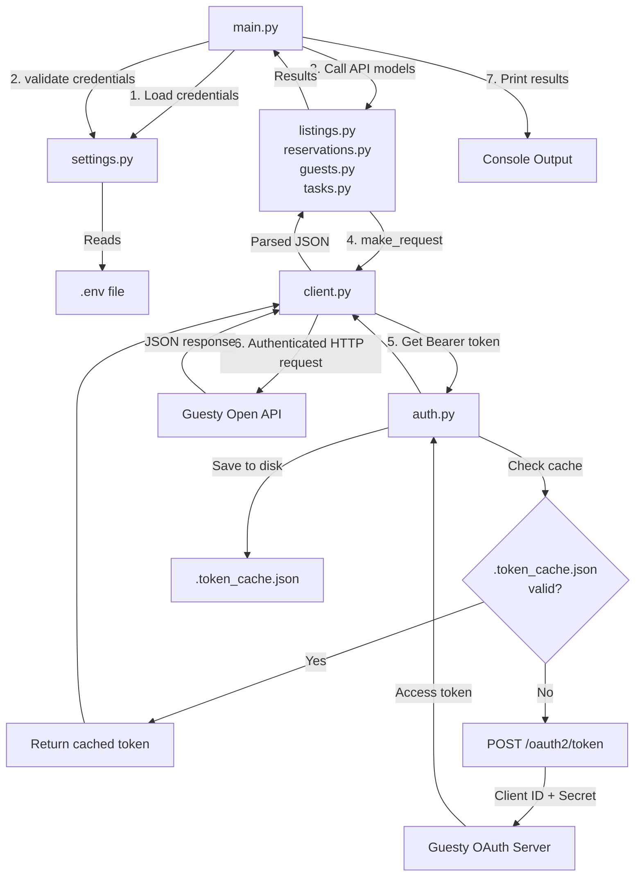
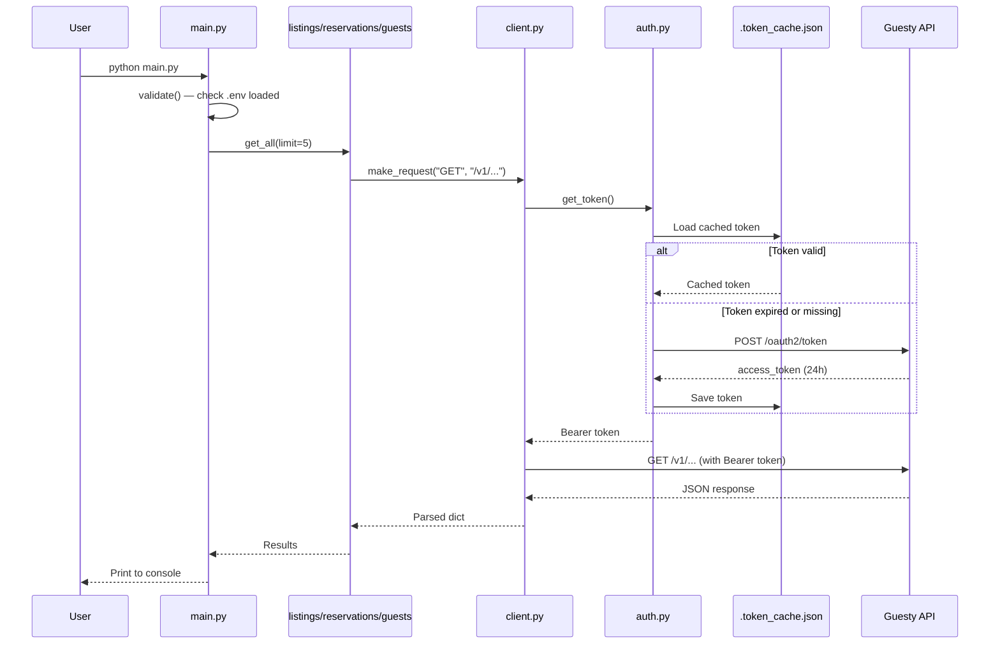

# Guesty API Client

Python client for the [Guesty Open API](https://open-api-docs.guesty.com) with OAuth 2.0 authentication, token caching, and modular model structure.

---

## Application Workflow



### Request Lifecycle



---

## Project Structure

```
Guesty-API/
├── .env                  # Your credentials (never commit this)
├── .env.example          # Template for credentials
├── .gitignore
├── .token_cache.json     # Cached OAuth token (auto-generated, never commit)
├── requirements.txt
├── main.py               # Entry point / connection test
├── settings.py           # Loads .env into variables
├── auth.py               # OAuth token fetching & disk-based caching
├── client.py             # Base HTTP request handler
├── listings.py           # Listing API calls
├── reservations.py       # Reservation API calls
├── guests.py             # Guest API calls
└── tasks.py              # Task API calls
```

---

## Setup

**1. Install dependencies**
```bash
pip install -r requirements.txt
```

**2. Configure credentials**
```bash
copy .env.example .env
```
Then open `.env` and fill in your `GUESTY_CLIENT_ID` and `GUESTY_CLIENT_SECRET`.
Get these from: **Guesty Dashboard → Integrations → API → Open API Keys**

**3. Run the connection test**
```bash
python main.py
```

---

## Usage Examples

```python
import listings
import reservations
import guests
import tasks

# Listings
all_listings = listings.get_all(limit=10)
single_listing = listings.get_by_id("abc123")
calendar = listings.get_calendar("abc123", "2026-03-01", "2026-03-31")

# Reservations
all_reservations = reservations.get_all(limit=10, status="confirmed")
single_res = reservations.get_by_id("res123")
reservations.approve("res123")

# Guests
all_guests = guests.get_all(limit=10)
new_guest = guests.create("Jane Smith", "jane@example.com", "+61400000000")

# Tasks
all_tasks = tasks.get_all(limit=10)
tasks.create({"title": "Clean room", "listingId": "abc123", "scheduledDate": "2026-03-01"})
```

---

## Token Management

- Tokens are cached to disk (`.token_cache.json`) and reused for 24 hours
- Auto-refreshes 5 minutes before expiry
- Guesty limits renewals to **3 per 24 hours** — the disk cache keeps you well within this

---

## Adding a New Model

1. Create `your_model.py` in the project root
2. Import `make_request` from `client`

```python
# webhooks.py
from client import make_request

def get_all() -> dict:
    return make_request("GET", "/v1/webhooks")
```
