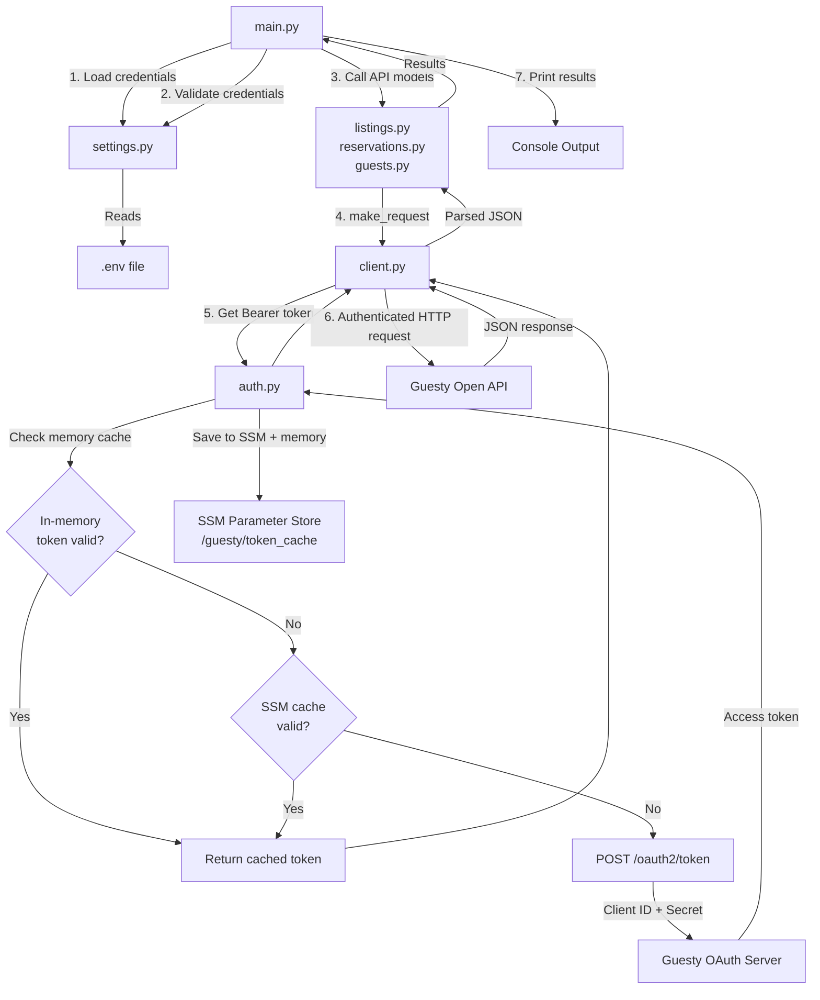
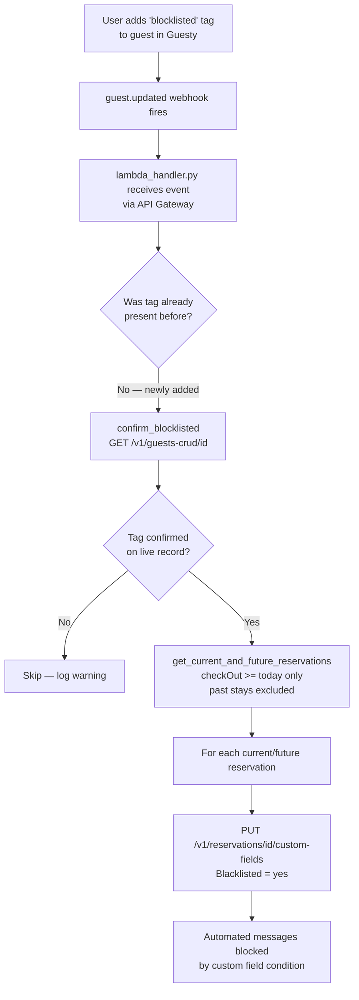
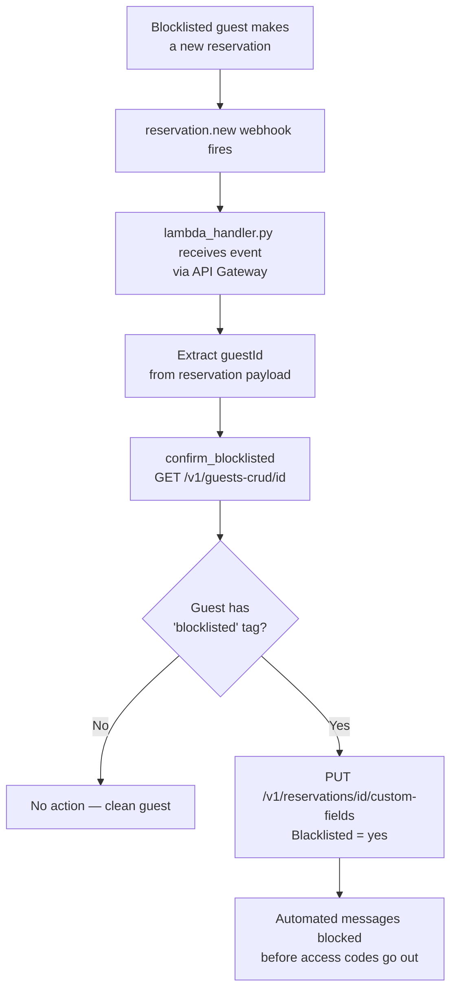
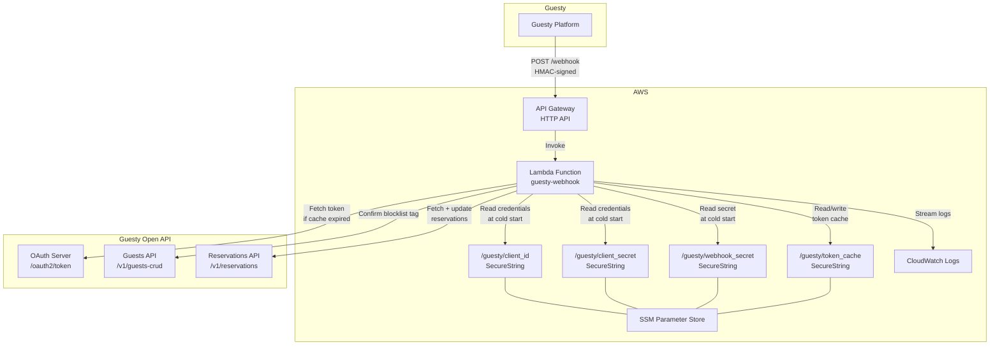
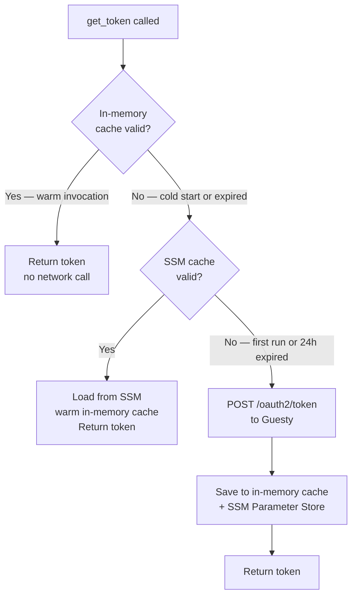

# Guesty API Client

Python client for the [Guesty Open API](https://open-api-docs.guesty.com) with OAuth 2.0 authentication, token caching, modular model structure, and automated blocklist enforcement via webhooks deployed on AWS Lambda.

---

## Table of Contents

- [Application Workflow](#application-workflow)
- [Blocklist Automation](#blocklist-automation)
- [AWS Lambda Architecture](#aws-lambda-architecture)
- [Token Caching Strategy](#token-caching-strategy)
- [Project Structure](#project-structure)
- [Local Setup](#local-setup)
- [Lambda Deployment](#lambda-deployment)
- [Configuring the Blacklisted Custom Field](#configuring-the-blacklisted-custom-field)
- [Usage Examples](#usage-examples)
- [Adding a New Model](#adding-a-new-model)

---

## Application Workflow



---

## Blocklist Automation

### The Problem

Guesty has two separate concepts that don't talk to each other:

| Concept | Scope | Can block automated messages? |
|---|---|---|
| `blocklisted` **tag** | Guest profile — follows the guest everywhere | No |
| `Blacklisted` **custom field** | Reservation-specific — must be ticked per reservation | Yes |

There is no native Guesty feature to automatically tick the custom field when the tag is present. This project bridges that gap via webhooks.

### Solution: Two Automated Triggers

#### Trigger 1 — Guest gets the `blocklisted` tag (`guest.updated`)



#### Trigger 2 — New reservation arrives from a blocklisted guest (`reservation.new`)



### Batch Reconciliation (`blocklist_workflow.py`)

In addition to real-time webhooks, a batch scan can be run manually or on a schedule as a safety net — to catch any guests tagged before the webhook was registered, or if a webhook delivery was missed.

```bash
python blocklist_workflow.py
```

---

## AWS Lambda Architecture

The webhook receiver runs as an AWS Lambda function exposed via API Gateway. There is no server to manage — Lambda scales automatically and costs nothing when idle.



### Component Responsibilities

| Component | Role |
|---|---|
| **API Gateway (HTTP API)** | Receives HTTPS POST from Guesty, forwards to Lambda |
| **Lambda (`guesty-webhook`)** | Runs the blocklist logic — stateless, scales to zero |
| **SSM `/guesty/client_id`** | Guesty API client ID (SecureString) |
| **SSM `/guesty/client_secret`** | Guesty API client secret (SecureString) |
| **SSM `/guesty/webhook_secret`** | HMAC signing secret for verifying Guesty requests |
| **SSM `/guesty/token_cache`** | Persisted OAuth token — shared across all Lambda instances |
| **CloudWatch Logs** | All Lambda output — automatically captured, no setup required |

---

## Token Caching Strategy

Guesty limits OAuth token renewals to **3 per 24 hours**. Lambda is stateless — each cold start loses in-memory state. A two-layer cache solves this:



| Cache layer | Scope | Speed | Survives cold start? |
|---|---|---|---|
| In-memory (`_mem_cache`) | Single Lambda container | ~0ms | No |
| SSM Parameter Store | All Lambda instances | ~30ms | Yes |

In practice, a Lambda container stays warm for 5–15 minutes. Most invocations hit the in-memory cache and never touch SSM. SSM is only read on a cold start, and only written when Guesty issues a new token (at most once per 24 hours).

---

## Project Structure

```
Guesty-API/
│
├── Core API client
│   ├── main.py                 # Entry point / connection test
│   ├── settings.py             # Loads credentials from env vars (or .env locally)
│   ├── auth.py                 # OAuth token fetching — in-memory + SSM cache
│   ├── client.py               # Base authenticated HTTP request handler
│   ├── reservations.py         # Reservation API calls
│   └── guests.py               # Guest API calls
│
├── Blocklist automation
│   ├── blocklist_workflow.py   # Batch: scan all guests and flag blocklisted reservations
│   └── lambda_handler.py       # AWS Lambda entry point (handler = lambda_handler.handler)
│
├── AWS deployment
│   └── template.yaml           # AWS SAM deployment template
│
├── Config & credentials
│   ├── .env                    # Local credentials — never commit
│   ├── .env.example            # Template for credentials
│   └── requirements.txt        # Python dependencies
│
└── Docs
    ├── README.md
    └── LAMBDA_DEPLOY.md        # Step-by-step Lambda deployment guide
```

---

## Local Setup

**1. Install dependencies**
```bash
pip install -r requirements.txt
```

**2. Configure credentials**
```bash
copy .env.example .env
```
Then open `.env` and fill in your values:

| Variable | Description |
|---|---|
| `GUESTY_CLIENT_ID` | Guesty Dashboard → Integrations → API → Open API Keys |
| `GUESTY_CLIENT_SECRET` | Same location |
| `GUESTY_WEBHOOK_SECRET` | Set once Guesty provides a signing secret for your endpoint |

**3. Run the connection test**
```bash
python main.py
```

---

## Lambda Deployment

See **[LAMBDA_DEPLOY.md](LAMBDA_DEPLOY.md)** for the full step-by-step guide. Summary:

### 1. Store secrets in SSM

```bash
aws ssm put-parameter --name /guesty/client_id      --value "YOUR_ID"     --type SecureString
aws ssm put-parameter --name /guesty/client_secret  --value "YOUR_SECRET" --type SecureString
aws ssm put-parameter --name /guesty/webhook_secret --value "YOUR_SECRET" --type SecureString
```

### 2. Build the ZIP

```bash
pip install -r requirements.txt --target package/ --upgrade
copy *.py package\
cd package && zip -r ../guesty_lambda.zip . && cd ..
```

### 3. Upload to Lambda

- **Handler:** `lambda_handler.handler`
- **Runtime:** Python 3.12
- **Timeout:** 30 seconds

Set these environment variables in the Lambda console:

| Variable | Value |
|---|---|
| `GUESTY_CLIENT_ID` | Your Guesty client ID |
| `GUESTY_CLIENT_SECRET` | Your Guesty client secret |
| `GUESTY_WEBHOOK_SECRET` | Your webhook signing secret |
| `TOKEN_CACHE_SSM_PARAM` | `/guesty/token_cache` |
| `LOG_LEVEL` | `INFO` |

### 4. Add API Gateway trigger

Add an **HTTP API** trigger to the Lambda function. Copy the endpoint URL.

### 5. Register in Guesty

**Guesty Dashboard → Integrations → Webhooks**, subscribe to:

| Event | Purpose |
|---|---|
| `guest.updated` | Detects when the `blocklisted` tag is added or removed |
| `guest.created` | Catches guests imported with the tag already present |
| `guest.deleted` | Logs the deletion for audit purposes |
| `reservation.new` | Flags new bookings from blocklisted guests immediately |

### 6. Verify

```bash
curl https://<your-api-gateway-url>/health
# → {"status": "healthy"}
```

---

## Configuring the Blacklisted Custom Field

In `blocklist_workflow.py`, update `BLACKLIST_CUSTOM_FIELDS_PAYLOAD` to match your exact Guesty custom field name or ID:

```python
# Object format (field name as key):
BLACKLIST_CUSTOM_FIELDS_PAYLOAD = {
    "blacklisted": "true",
}

# Array format (if Guesty uses field IDs):
BLACKLIST_CUSTOM_FIELDS_PAYLOAD = [
    {"fieldId": "YOUR_FIELD_ID", "value": "true"}
]
```

To find your field ID, run the batch workflow — it prints current custom fields for each reservation:
```
Custom fields for GY-xxxx: [{'fieldId': 'abc123', 'value': '...'}]
```

---

## Usage Examples

```python
import reservations
import guests

# Reservations
all_reservations = reservations.get_all(limit=10, status="confirmed")
single_res = reservations.get_by_id("res123")
reservations.approve("res123")

# Guests
all_guests = guests.get_all(limit=10)
new_guest = guests.create("Jane Smith", "jane@example.com", "+61400000000")
```

---

## Token Management

| Context | Cache location | Survives restart? |
|---|---|---|
| Local dev | In-memory only | No |
| Lambda (warm) | In-memory (`_mem_cache`) | Until container recycles |
| Lambda (cold start) | SSM Parameter Store | Yes — shared across all instances |

- Auto-refreshes 5 minutes before expiry
- Guesty limits renewals to **3 per 24 hours** — the two-layer cache keeps you well within this even with concurrent Lambda invocations

---

## Adding a New Model

1. Create `your_model.py` in the project root
2. Import `make_request` from `client`

```python
# example: webhooks.py
from client import make_request

def get_all() -> dict:
    return make_request("GET", "/v1/webhooks")
```
